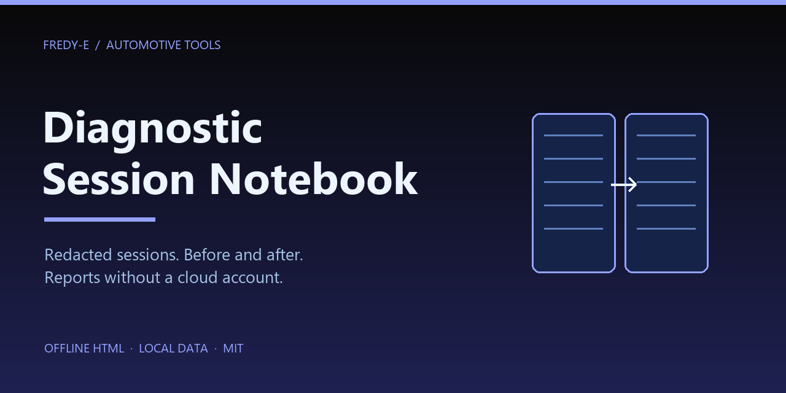
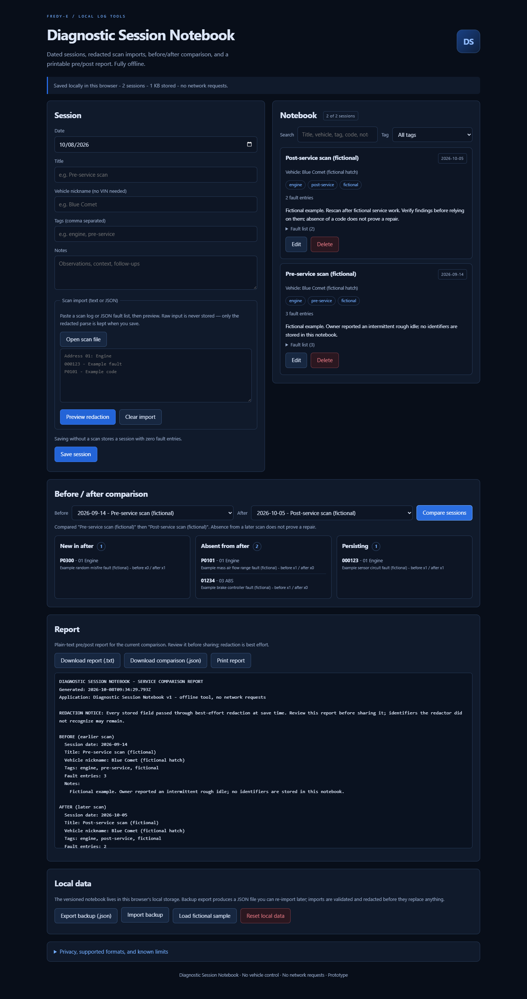

# Diagnostic Session Notebook



Development and CI: [verification instructions](docs/verification.md).

An offline notebook for diagnostic scan sessions: dated entries with a friendly
vehicle nickname, tags, and notes; redacted text/JSON scan imports; fault lists;
before/after comparison grouped into new / absent / persisting; and a printable
pre/post report. Runs by opening `index.html` from disk — no server, no install,
no CDN, no network requests, no telemetry.

Part of the Blue-family local log tools (same dark palette as Diagnostic Scan Diff).

## Screenshot



## Quick start

1. Open `index.html` directly from disk (double-click, or drag into a browser).
2. Name the session, paste a scan log (or open a `.txt` / `.log` / `.json` file),
   and press **Preview redaction** to see exactly what would be stored.
3. **Save session**. Repeat with a later scan.
4. Pick *Before* and *After* sessions and press **Compare sessions**.
5. **Download report (.txt)**, **Download comparison (.json)**, or **Print report**.

## Privacy model

- **Redact before storing.** Raw scan text and unredacted previews are never
  persisted anywhere: redaction runs at parse time, and only the redacted result
  reaches local storage. The raw text lives only in the textarea until you save.
- **Metadata is redacted too.** Titles, vehicle nicknames, tags, and notes pass
  through the same redaction engine before storage, so identifier leakage through
  those fields is prevented as well.
- **JSON imports are normalized safely.** Structured imports may carry raw fields
  (`vin`, `licensePlate`, `serialNumber`, …): identifier-style keys are dropped
  entirely, and every stored string (fault descriptions, modules, title, vehicle,
  notes, tags) is redacted before the session is committed. Backup imports are
  re-validated and re-redacted, then written atomically.
- **Best effort — review exports.** The redactor recognizes labeled identifiers
  (VIN / chassis / license plate / registration / serial, with `:`, `=`, or bare
  forms and `_`-style keys) and VIN-like 17-character strings. Identifiers in
  shapes it does not recognize may remain. Always review previews and exports
  before sharing them.

## Features

- Dated sessions with title, friendly vehicle nickname (no VIN required), tags,
  and notes. Editing and deleting both require explicit confirmation.
- Scan import from paste or file (text or JSON), with a redaction preview that
  shows the redacted text, redaction counts by type, warnings, and the parsed
  fault list.
- Fault list per session: module, code, description, occurrence count.
- Search (title/vehicle/tags/codes/descriptions/notes) and tag filter.
- Before/after selects with grouped comparison: **new**, **absent**, **persisting**
  (keyed by module + code, like the Scan Diff starter). "Absent" describes only
  the two logs you selected — it does not prove a repair.
- Plain-text pre/post report with both sessions' notes, full evidence (every code
  with before/after occurrence counts), warnings, and the limitations section.
- Blob downloads with `URL.revokeObjectURL` cleanup; print styles render only the
  report panel.
- Fictional sample data (clearly labeled) that demonstrates a full comparison.
  Loading it never overwrites user records without a confirmation dialog.
- Dark blue, responsive, accessible UI. All user text renders via `textContent` /
  `createTextNode`; imported content can never become HTML, scripts, or links.

## Supported import formats (first version)

- **Text:** VCDS-style `Address 01: Engine` headers, `[Module]` headers, numeric
  `code - description` lines (4–7 digits), and five-character P/B/C/U codes
  (`P0101`, `B1234`, `C0562`, `U0100`). Duplicates collapse with a count.
  Timestamps like `2024-09-01 10:00` are not mistaken for fault codes.
- **JSON:** an array of `{module, code, description}` objects, or an object with a
  `faults` array plus optional `title`, `vehicle`, `notes`, `tags`. Unknown fields
  are ignored (with a warning); identifier keys are dropped.
- **Unknown layouts may parse incompletely.** A zero-fault parse is a warning, not
  a clean bill of health; the UI says so and asks you to verify the source.

## Limitations (by design, stated honestly)

- Redaction is best effort; unrecognized identifier shapes can survive. Review
  before sharing.
- Absence from a later scan does not prove a fault was repaired, and no scan
  proves completeness of the underlying diagnostic session.
- The notebook performs no vehicle control and is not a safety assessment.
- The parser is heuristic; it does not validate codes against a manufacturer
  database.

## Local data

- Versioned store in `localStorage` under key `diagnostic-session-notebook.v1`
  (payload carries `version: 1`).
- If storage is blocked or the quota is exceeded, the notebook keeps working in
  memory and says so **visibly** ("In-memory only…") instead of pretending to save.
- Corrupt or future-version stored data is **not loaded and not overwritten**;
  saving stays blocked until you reset local data or import a backup.
- Live limits: 5 MB total stored data · 250 sessions · 500 fault entries per
  session · 5 MB per import · 5,000 raw JSON rows · 120-char titles · 60-char
  vehicle nicknames · 4,000-char notes · 20 tags of 32 chars · 300-char fault
  descriptions · 60-char fault module names. Failed imports leave all existing
  state untouched.

## Reports and exports

| Download | Filename | Notes |
| --- | --- | --- |
| Report | `diagnostic-notebook-comparison-YYYY-MM-DD.txt` | Plain text, printable, includes notes + evidence + limitations |
| Comparison | `diagnostic-notebook-comparison-YYYY-MM-DD.json` | Both session summaries + full diff + limitations |
| Backup | `diagnostic-notebook-backup-YYYY-MM-DD.json` | Whole versioned store, re-importable |

All three are real `Blob` downloads and object URLs are revoked after the click.
Backup import is transactional: validate → re-redact → single atomic write; on
any failure nothing is changed.

A comparison is tied to the stored sessions: any applied store change (save,
edit, delete, sample load, backup import, reset) invalidates the current
comparison and its report — the download/print buttons disable and the preview
resets — so a stale report can never be exported. Run **Compare sessions**
again to rebuild it.

## Development

No runtime dependencies. Unit and app-regression tests use the built-in Node
test runner; the browser suite uses the pinned Playwright development
dependency only:

```sh
npm test                            # unit + app-regression suites
node tests/core.test.cjs            # core logic + static safety scans
node tests/app-regression.test.cjs  # app wiring regression (DOM sandbox)
node --test                         # via the test runner (auto-discovers tests/)
npm run test:browser                # Playwright browser verification
```

Covered: redaction (labels, VIN-like strings, idempotency, metadata), text and
JSON parsing, numeric/PBCU codes, dedup, dates/schema/size/count limits, storage
fallbacks (blocked, quota, corrupt, version), transactional backup import,
comparison grouping, report/report-JSON/backup safety (no raw identifiers), the
fictional sample, static offline-safety scans of the shipped files, and the DOM
contract for browser tests. App-level regression tests additionally drive the
real `app.js` inside a dependency-free DOM sandbox: comparison invalidation
after edits, replacements, unrelated additions, deletes, and failed writes kept
in memory (stale-report export guard).

## Browser-verification contract (for Playwright)

- Open `file:///…/Diagnostic-Session-Notebook/index.html` and wait for
  `[data-testid="app"][data-ready="true"]`.
- Storage key: `window.Notebook.STORAGE_KEY` → `diagnostic-session-notebook.v1`.
- Core API: `window.Notebook` with `redactText`, `parseScan`, `compareFaults`,
  `createSession`, `updateSession`, `validateStore`, `loadStoreFrom`,
  `saveStoreTo`, `importBackupText`, `buildReportText`, `buildComparisonJson`,
  `buildBackupJson`, `exportFilenames`, `sampleData`, `LIMITS`, `SCHEMA_VERSION`.
- Read-only debug hook: `window.__notebookDebug` exposes the storage key, storage
  mode, protection flag, and session count (no data).
- Stable test ids — static shell: `app`, `storage-status`, `toast`, `session-form`,
  `session-date`, `session-title`, `session-vehicle`, `session-tags`,
  `session-notes`, `import-text`, `import-file`, `import-format-note`,
  `preview-button`, `clear-import`, `preview-panel`, `preview-summary`,
  `preview-text`, `preview-faults`, `fault-count`, `save-session`, `cancel-edit`,
  `edit-banner`, `session-list`, `session-count`, `search-input`, `tag-filter`,
  `empty-state`, `before-select`, `after-select`, `compare-button`,
  `compare-note`, `diff-new`, `diff-absent`, `diff-persisting`,
  `diff-new-count`, `diff-absent-count`, `diff-persisting-count`,
  `diff-new-list`, `diff-absent-list`, `diff-persisting-list`, `report-preview`,
  `download-report`, `download-compare-json`, `print-report`, `export-backup`,
  `import-backup-file`, `load-sample`, `reset-data`, `confirm-dialog`,
  `confirm-title`, `confirm-message`, `confirm-yes`, `confirm-no`.
- Same test ids are asserted by `tests/core.test.cjs`, so the contract cannot
  silently drift.
- Dynamic selectors: `[data-testid="session-card"][data-session-id]`,
  `card-title`, `card-date`, `card-vehicle`, `card-tags`, `card-faults-count`,
  `card-fault-list`, `edit-session`, `delete-session`,
  `[data-testid="diff-item"][data-group][data-code]`.
- Suggested flow: fill `import-text` with a log containing a fictional VIN/plate →
  `preview-button` (preview must already show `[REDACTED:…]` and no raw identifier)
  → `save-session` → read `localStorage` (no raw identifier; `[REDACTED:VIN]`
  present) → reload (card persists) → `load-sample` + confirm → `before-select` /
  `after-select` → `compare-button` → assert diff counts → download
  `download-report` and assert the file contains no original identifiers.

## Files

```
index.html        UI shell (no inline scripts; local scripts only)
core.js           pure logic (browser global + CommonJS export)
app.js            UI wiring (textContent only, no HTML strings)
style.css         dark blue family styling, responsive, print styles
tests/core.test.cjs  Node unit tests + static safety scans
tests/app-regression.test.cjs  app-level regression tests (DOM sandbox, no dependencies)
tests/browser.cjs Playwright browser verification (development dependency)
package.json      npm scripts and the pinned Playwright dev dependency
.github/workflows/verify.yml  CI: npm ci, unit suite, browser suite
docs/verification.md  development and CI verification instructions
assets/banner.png decorative project card
LICENSE           MIT license text
README.md         this file
.gitignore        node_modules, logs, OS noise
```

## Reuse & attribution

Portions of the parsing/redaction/comparison approach are adapted from the
MIT-licensed `Diagnostic-Scan-Diff` starter (`starters/Diagnostic-Scan-Diff/scan.js`):
the VCDS-style text parsing shape, the labeled-identifier redaction approach, the
5 MB input cap, and the module|code comparison keying. That repository was read
only and is not modified by this project. The visual language follows the same
family palette as that tool.

## License

Licensed under [MIT](LICENSE), as chosen by the owner. The adapted MIT starter is
attributed above.

## Status

Deployable prototype with its full test stack in the repository: unit and
app-regression suites (`npm test`), a Playwright browser suite
(`tests/browser.cjs`, `npm run test:browser`), and a configured CI workflow
(`.github/workflows/verify.yml`) that runs both. A configured workflow is not
evidence of a completed hosted run: Linux and Node 22 must be verified at the
exact published commit (see `docs/verification.md`). Publication is a separate
step.
